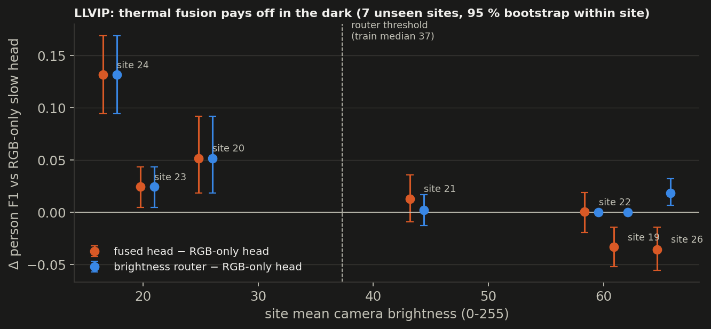

# Night Watch: camera + thermal + LiDAR perception for security robots after dark

Two heads read the same camera, thermal and LiDAR frame. A **9B vision-language model** (Qwen3.5-9B + LoRA) writes an
incident report with posture and metric range. A **12M-parameter detector** runs in 0.7 ms on TensorRT. Every number
below comes from **sites neither model saw in training**, including a forest at night where the camera is black.

**In short.** Each result is backed by site-level confidence intervals, three seeds where seeds vary, and a fail-closed
regression gate.
- **LLVIP (RGB + thermal, 7 unseen sites):**
  - The best model is the simplest fusion: the 9B fine-tuned on both images. It reaches 0.937, and at least 0.89 with either
    camera dead.
  - My native-encoder side-branch fusion lost to it on all 7 sites, and the gate blocked it.
  - Self-training beats distilling the 9B into the small head on F1. The 9B teacher only improves ranking.
- **TriSAR-3D (RGB + thermal + LiDAR, unseen forest at night):**
  - With thermal fused as a side branch, the 9B models are blind in the dark forest (F1 0.00). With thermal fed as its
    own image, the 9B sees there for the first time (forest F1 0.33, precision 0.29). The LiDAR fast head stays the most
    precise (0.37 at P 0.8).
  - A fused 9B trained with camera-dropout hallucinated 3,373 people. The same model without dropout reported none:
    the augmentation, not the extra sensors, taught the hallucination.
  - The best system pairs that fused 9B (posture, range) with a thermal-normalised LiDAR fast head: 0.49 over 3 seeds,
    against 0.36 for the fast head alone.


*Unseen forest, night (TriSAR-3D test). Left: the camera is almost black. Middle: thermal plus LiDAR coloured by range, with
ground truth in white. Right: the VLM says "nobody visible" and the LiDAR-driven fast head finds both people with
posture and range. This window was chosen as the forest's best; that fast head's overall forest F1 is 0.31 (seed 0; 0.30 mean over 3 seeds).*


## Results at a glance (TriSAR-3D held-out test, 2,751 frames, person F1 @ IoU 0.5)

| system | all | night | unseen forest | held-out lab |
|---|---|---|---|---|
| VLM zero-shot, RGB (600-frame subset) | 0.07 | – | – | – |
| VLM fine-tuned, RGB only | 0.25 | 0.16 | 0.00 | 0.78 |
| VLM fine-tuned, RGB + thermal + LiDAR, 20 % camera-dropout | 0.17 | 0.11 | 0.00 | 0.79 |
| VLM fine-tuned, RGB + thermal + LiDAR, **no camera-dropout** (2 seeds) | **0.26 / 0.25** | **0.17** | 0.00 | **0.82 / 0.80** |
| VLM fine-tuned, RGB + thermal + LiDAR, 50 % camera-dropout | 0.24 | 0.16 | 0.00 | 0.76 |
| VLM fine-tuned, thermal as its own image (no camera, no LiDAR) | 0.41 | 0.38 | 0.33 | 0.82 |
| VLM fine-tuned, camera + thermal as two images | 0.48 | 0.45 | 0.39 | 0.86 |
| **VLM fine-tuned, camera + thermal + LiDAR as three images** (2 seeds) | **0.52 (0.51–0.53)** | **0.49** | **0.44 (0.43–0.44)** | **0.84** |
| fast head, 12M (mean of 3 seeds, range) | 0.36 (0.30–0.40) | 0.33 (0.27–0.38) | **0.30 (0.24–0.36)** | 0.56 (0.55–0.57) |
| combined: VLM (camera-dropout) + non-overlapping fast detections (3 seeds) | 0.42 (0.35–0.46) | 0.37 (0.31–0.42) | 0.30 (0.24–0.35) | 0.76 |
| fast head + per-frame thermal normalisation (3 seeds) | 0.42 (0.37–0.45) | 0.39 (0.35–0.43) | **0.37 (0.31–0.42)** | 0.56 (0.56–0.57) |
| combined: VLM (camera-dropout) + normalised fast head (3 seeds) | 0.47 (0.44–0.51) | 0.43 (0.39–0.47) | 0.37 (0.31–0.42) | 0.76 |
| combined: RGB-only VLM + normalised fast head (3 seeds) | 0.48 (0.44–0.51) | 0.44 (0.39–0.48) | 0.37 (0.31–0.42) | 0.78 |
| **combined: fused VLM (no dropout) + normalised fast head** (3 seeds) | **0.49 (0.45–0.52)** | **0.45 (0.40–0.49)** | **0.37 (0.31–0.42)** | **0.81** |

What the runs show:

1. **Combining the heads wins, but only with a VLM that abstains.** The combined output gains +0.054 to +0.066 F1 over
   the fast head alone, on every fast-head seed. The fast head's absolute level varies a lot by seed (0.30–0.40), and
   validation F1 does not predict which seed generalises, but the gain does not vary. With a VLM that invents people in
   the dark, the same combination *loses* to the fast head (0.32 vs 0.37).
2. **Camera-dropout caused the hallucinations, not the extra sensors.** On 2,119 forest frames (four unseen night
   sequences), people reported by each slow head:

   | slow head | people reported |
   |---|---|
   | RGB only | 6 |
   | RGB + T + LiDAR, 20 % camera-dropout | **3,373**, nearly all wrong |
   | RGB + T + LiDAR, 50 % camera-dropout | 39, 1 correct |
   | RGB + T + LiDAR, **no** camera-dropout | **0** |

   Camera-dropout with the lab people kept as targets on black frames taught the model "black camera ⇒ report
   people". Without dropout, the fused model reports almost nobody in the forest (0 and 4 reports over two seeds). On
   both seeds it is also the strongest TriSAR slow head (held-out lab 0.817 / 0.801 vs 0.781 RGB-only, gate SHIP
   twice). Its sensor ablations show it barely uses thermal or
   LiDAR (point 3), so that gain is not fusion; it is a consistent side effect of training with the extra branches. Why 50 % dropout hallucinates far
   less than 20 % is still open.
   The lesson: an augmentation that keeps labels the input no longer supports teaches a prior, and only an unseen
   site exposed it.
3. **None of the TriSAR VLMs learned to use thermal or LiDAR.**
   - Switching either sensor off, or feeding both from another frame, changes held-out-lab F1 by less than 0.03 (on the 153 lab frames of the fixed 600-frame subset). This
     holds for all three fused runs, including the one without camera-dropout (thermal or LiDAR off: −0.013).
   - With the camera off, the VLM emits the same memorised box on every frame.
   - The fused features had large norms during training but carried no decision signal.
   - The design itself can fuse: on LLVIP, the same side-branch fusion depends on thermal spatially (misaligned thermal
     0.53 vs no thermal 0.88) and keeps **F1 0.80 with the camera off**.
   - On TriSAR, one epoch on 6k frames with two new encoders and a camera that was already sufficient on lab training
     frames did not get there. Since then, "ablating a sensor must hurt" is a check I run on every fused model.
4. **The fast head runs on LiDAR, until thermal is normalised.** Across 3 seeds, LiDAR off drops the plain fast head
   from 0.30–0.40 to 0.19–0.24, and thermal off does not hurt it, because raw thermal shifts between sites. A per-frame
   thermal level match applied in training *and* inference makes thermal usable:
   - With LiDAR off, every normalised seed (0.26–0.31) beats every plain seed.
   - Mean forest F1 rises 0.30 → 0.37, though the seed ranges still overlap.
   - Lab and validation scores do not move. Only the unseen site shows the difference.
   - The trick was prompted by the forest failure, so it counts as a development result.
5. **Escalating the VLM only on uncertain frames did not beat random escalation.** Fast-head doubt sits in the forest,
   where the VLM abstains. This is logged as a negative result.


## LLVIP: fusion and distillation (RGB + thermal street cameras, 1,500 frames from 7 unseen sites)

95 % intervals come from resampling whole sites, not frames. Every row is scored on the same frames; "darkest 25 %" is the 367 frames with the lowest camera brightness. Sensor-off columns use a fixed 800-frame subset for the 9B rows (marked * for the full test set).

| model | F1 | 95 % site CI | camera off | thermal off | worst single failure | darkest 25 % |
|---|---|---|---|---|---|---|
| Qwen3.5-9B zero-shot, RGB | 0.839 | 0.80–0.88 | 0.00 | n/a | 0.00 | 0.832 |
| zero-shot, thermal as a 2nd image | 0.696 | 0.64–0.78 | 0.20 | 0.83 | 0.20 | – |
| 9B fine-tuned, RGB only (same recipe) | 0.882 | 0.83–0.92 | 0.00 | n/a (no thermal input) | **0.00** | 0.820 |
| 9B fine-tuned, thermal only (thermal fed as the image) | 0.923 | 0.89–0.95 | n/a (no camera input) | 0.00 | **0.00** | 0.891 |
| 9B fine-tuned, thermal fused as a side branch onto the RGB tokens | 0.894 | 0.87–0.93 | 0.80 | 0.88 | 0.80 | 0.902 |
| **9B fine-tuned, RGB and thermal as two images** (2× visual tokens) | **0.937** | **0.92–0.95** | **0.93** | **0.89** | **0.89** | **0.916** |
| 9B fine-tuned, two images at half resolution (~714 tokens, same as the fused model) | 0.928 | 0.90–0.94 | 0.91 | 0.88 | 0.88 | – |
| brightness router: fused head on dark frames, RGB-only head on bright ones | 0.910 | 0.89–0.94 | – | – | – | 0.902 |
| 12M fast head, 7 labelled sites (3 seeds) | 0.82 (0.80–0.83) | | 0.83 (s0) | 0.68* (s0) | 0.68* | 0.77 (0.75–0.79) |
| … same, trained for as many steps as the pseudo-label students (3 seeds) | 0.84* (0.83–0.86) | | 0.83* (s0) | 0.41* (s0) | 0.41* | |
| 12M fast head, self-training on the 11 unlabeled sites (control) | 0.864 | 0.82–0.89 | 0.85* | 0.72* | 0.72* | 0.841 |
| 12M student of the 9B, consensus-filtered labels on 11 unlabeled sites (seeds 0 / 1 / 2) | 0.866 / 0.834 / 0.867 | 0.83–0.89 (s0) | 0.85* (s0) | 0.72* (s0) | 0.72* | 0.852 (s0) |
| 12M fast head, human labels on all 18 sites (oracle) | 0.857 | 0.83–0.88 | 0.84* | 0.67* | 0.67* | 0.839 |

- **The simple baseline wins.** Fine-tuning the 9B on RGB and thermal as two separate images gives the best model on
  every axis:
  - average 0.937, +0.013 over thermal-only [+0.003, +0.027] on 6/7 sites, and +0.055 over RGB-only on 7/7
  - worst single sensor failure 0.89 (camera dead 0.93, thermal dead 0.89)
  - its cost is twice the visual tokens

  Zero-shot, the same input was the *worst* model (0.696: it counts people twice across the two images). That
  zero-shot result is what motivated my side-branch design, and the motivation does not survive fine-tuning.
- **My side-branch fusion lost to it, even at the same token budget.**
  - Against the full two-image model: −0.043 [−0.071, −0.013], worse on all 7 sites.
  - Against a two-image model at half resolution (~714 visual tokens, the same budget as my fused model's 720), it
    still loses: 0.894 vs 0.928, −0.035 [−0.063, −0.006], 7/7 sites, worst single failure 0.80 vs 0.88. The gate
    passes the half-resolution two-image model against it.
  - Doubling the resolution adds only +0.009.
  - So the side branch has no remaining advantage on LLVIP. The fail-closed
  regression gate blocked it against every stronger baseline. That gate is the part of this project I would carry to a
  production fusion team.

  

- Other comparisons on the same frames:
  - Thermal-only beats RGB-only by +0.042 [+0.007, +0.074].
  - The side-branch fusion beats RGB-only only in the dark: +0.13 on the darkest site, −0.03 on the two brightest.
  - A brightness router between the fused and RGB-only heads reaches 0.910 (exploratory, designed after seeing the
    per-site pattern).
- Thermal as a plain second image *hurts* zero-shot on all 7 sites.


- **Distillation from the 9B did not beat self-training on F1.** Pseudo-labelling the 11 unlabeled sites closes the gap
  to the human-label oracle, but the 12M head's own labels do it equally well (0.864 vs 0.866 for the consensus-filtered
  9B labels, Δ +0.002 [−0.010, +0.019], same frames), and one of three consensus seeds falls back to 0.83 when its validation threshold lands high. The
  pre-registered self-training control caught this. What the teacher reliably transfers is ranking quality: AP50 0.90–0.91
  for all four VLM-labelled students (oracle 0.912), against 0.893 for self-training and 0.877 labelled-only. The F1
  operating point does not survive a one-site validation set. Its labels on the unlabeled sites (F1 0.82 vs withheld
  GT, with hallucinated lamps and foliage at two bright sites) are no better than the small head's own confident labels
  on easy LLVIP pedestrians.
- **Self-training is mostly, but not only, more steps.** Over three seeds on the full test set:

  | | mean F1 | range |
  |---|---|---|
  | labelled-only | 0.821 | 0.805–0.833 |
  | labelled-only trained for as many steps | 0.844 | 0.827–0.861 |
  | self-training | 0.859 | 0.855–0.862 |

  Self-training minus compute-matched, seed by seed, is +0.019 and +0.028 (significant) and −0.001. The self-labelled
  data adds about +0.015 beyond extra steps, and self-training is the most stable of the three recipes.
- **Fusion is spatial, and misalignment is dangerous.** With thermal taken from a different frame, the 9B drops to 0.53
  (0.88 with thermal simply off). A sync or calibration fault is worse than a dead thermal camera.

\* full 3,463-frame test set (camera-off cells and the compute-matched row); all other cells use the 1,500 frames.

- Escalation works when the slow head is competent everywhere. Sending the 20 % most uncertain frames to the 9B
  recovers 61 % of the fast→slow gap (random: 28 %). On TriSAR, where the 9B is blind at night, the same rule loses to
  random. Routing must know which head to trust for the scene.

## A genuinely new site: the LTDv2 harbour (fast head, 3 seeds)

The LLVIP thermal fast head is dropped onto LTDv2: a harbour thermal camera in another country, at 384×288, with
people a median 16–19 px tall.
- It adapts on 2,000 unlabelled frames from May 2020.
- It is tested on March–April 2021: 15,925 frames in 142 clips, never used for any choice.
- Every arm gets the same 3,000 fine-tuning steps from the same start model.
- Thresholds come from the LLVIP validation site only.

| labels for the adaptation month | F1 @ IoU 0.5, mean (range) | AP50 |
|---|---|---|
| none (zero-shot) | 0.132 | 0.072 |
| none, same extra steps on LLVIP | 0.135 (0.130–0.138) | 0.067 |
| the fast head's own labels (self-training) | 0.140 (0.129–0.145) | 0.085 |
| 9B box kept only where the fast head agrees (consensus) | 0.234 (0.228–0.246) | 0.219 |
| **thermal 9B labels** | **0.460 (0.446–0.469)** | **0.374** |
| human labels (upper bound; 2 of 3 seeds so far) | 0.573 (0.571–0.574) | 0.519 |

Paired bootstrap over the 142 test clips, per seed:
- **Pre-registered primary contrast, consensus − self-training: +0.098 [+0.088, +0.109] and +0.101 [+0.091, +0.111].**
- Pre-registered secondary, self-training − extra steps: ≤ +0.008.
- 9B labels − self-training: +0.33 (post hoc).

The 9B's labels recover about 75 % of the zero-shot → human-label gap with no human label at the new site, and the
adapted head does not get worse at home (LLVIP 0.870 vs 0.859). This is the opposite of LLVIP, where the teacher added
nothing on F1. At the harbour the small head finds 5 % of people, so its own labels are empty. **The teacher matters
when the student is out of its depth.** The consensus filter that helped on LLVIP hurts here, because a student that
barely fires vetoes most real people.

Site memory: a JEPA-style latent predictor on LTDv2 (one harbour camera over 8 months) detects inserted persons at AUROC
0.70 (pixel baseline 0.52) and crowds at 0.85 (token baseline 0.67).

Engineering notes:
- Every comparison is same-subset, and regression gates fail closed.
- Four leak and overwrite bugs were caught before they reached results; see `docs/LAB_NOTES.md` §2.
- Independent reviews (Fable, Astra) and their triage are in `docs/reviews/`.

---

## Design (stage 1, LLVIP)

A small-scale, end-to-end version of a multi-sensor perception stack for security robots:

1. **Native sensor encoders**: the VLM's own ViT for the visible camera, plus a DINOv3 ConvNeXt with a
   1-channel stem for raw thermal.
2. **Fusion**: thermal features land exactly on the VLM's 2×2-merged visual token grid (stride 32 ↔ 32 px
   tokens), and are added onto the RGB tokens (and onto DeepStack levels where the VLM has them) through
   zero-initialised output projections (ControlNet-style; a zero *gate* was tested and starves the
   projection of gradient, so the model never used thermal). The result is one spatially aligned token stream with the same token budget as RGB alone, and
   at step 0 the model is exactly the pretrained VLM.
3. **Slow head**: Qwen3.5-9B (natively multimodal, Feb 2026; any Qwen3.5/3.6 or Qwen3-VL works via `NW_MODEL`), LoRA-tuned to reason over the fused stream (grounding, counting, zone
   checks). It is trained on 7 labeled sites only.
4. **Fast head**: a 12M-parameter CenterNet on early-fused RGB+T, distilled from the slow head's labels on
   11 unlabeled sites. It has no NMS, exports to ONNX/TensorRT, and sees every frame. Only ambiguous
   frames escalate to the slow head.
5. **Evaluation**: every test number comes from **held-out sites** (LLVIP test scenes share no location
   with training). The slices are darkest-25%, crowded, per-site, far/mid/near persons, *visible camera
   dead* and *thermal dead*. A regression gate blocks any candidate that is worse on any slice.

## Data: LLVIP, split by scene

| split | scenes | frames | used for |
|---|---|---|---|
| labeled | 01–07 | 3,438 | slow-head SFT (the only human labels the slow head sees) |
| val | 25 | 423 | checkpoint + threshold selection |
| unlabeled | 08–18 | 8,164 | "field data": the slow head labels it, the fast head learns from that |
| test | 19–24, 26 | 3,463 | held-out sites, reporting only |

## Experiments

| id | what | question |
|---|---|---|
| `zs_rgb`, `zs_dual` | zero-shot Qwen3.5-9B | how far does the open model get with no training? |
| `sft_rgb` | LoRA, visible only | how much does fine-tuning alone buy? |
| `sft_dual` | LoRA, thermal as a 2nd image | strong simple baseline (2× tokens) |
| `sft_fusion` | **ours**: native thermal encoder + gated token fusion | same tokens as RGB alone. Better? More robust? |
| `fast_gt_labeled` | fast head on the 7 labeled sites | what the labels alone buy |
| `fast_distill` | fast head on labeled + slow-head pseudo-labels | does the slow head's knowledge transfer? |
| `fast_oracle` | fast head on all GT | upper bound |
| `fast_oracle_rgb/_t` | single-sensor ablations | thermal-only fast head 0.860 vs RGB+T 0.855 (full test): thermal alone is as good for the small head too; RGB-only 0.783 (AP50 0.816) |

## Stage 2 — TriSAR-3D: RGB + thermal + LiDAR (CC-BY-4.0, TU Darmstadt, Oct 2026)

19.7k synchronised frames from a 128-beam Ouster LiDAR, an RGB camera and a FLIR thermal camera, with 52k 3D person
boxes and posture tags (standing, walking, sitting, lying). Everything is rendered into one reference frame, the
undistorted thermal camera:

- RGB is warped in with the infinite-depth homography. The cameras are about 10 cm apart, so residual parallax is a few
  pixels, well under one visual token.
- LiDAR is z-buffer projected into inverse-range, intensity and hit maps.
- 3D boxes are projected to tight 2D boxes and keep their posture and metric range.

LiDAR therefore enters the slow head exactly like thermal: its own DINOv3 encoder, added onto the same visual token grid
through a zero-initialised projection.

**Split (ours, by sequence):** test is the whole forest (an unseen site at night) plus two held-out lab sequences with
lying persons. The official split is frame-level within sequences, which leaks near-duplicate frames.

**Task:** an incident report per person, `{"bbox_2d", "pose": upright|sitting|lying, "distance_m"}`, plus "is anyone
lying down?" and "how far is the nearest person?". Every answer is checked against the 3D labels.

| id | sensors | question |
|---|---|---|
| `t_zs_rgb` | RGB, zero-shot | what does the stock VLM get? |
| `t_sft_rgb` → `t_sft_fusion` → `t_sft_fusion_l` | RGB → +thermal → +LiDAR | what does each sensor add? |
| `tf_rgb`, `tf_rgbt`, `tf_tl`, `tf_rgbtl` | fast head, same ladder | does the fast head need the camera at all? |

Run it with `bash scripts/run_trisar.sh`.

## Run

```bash
bash scripts/setup.sh        # deps, LLVIP (4 GB), Qwen3.5-9B, DINOv3 weights, index
bash scripts/run_all.sh      # everything, resumable; logs in logs/, results in runs/, report in report/
```

Multi-GPU slow head: `torchrun --nproc_per_node 8 -m nightwatch.slow.train --mode fusion ...`.
