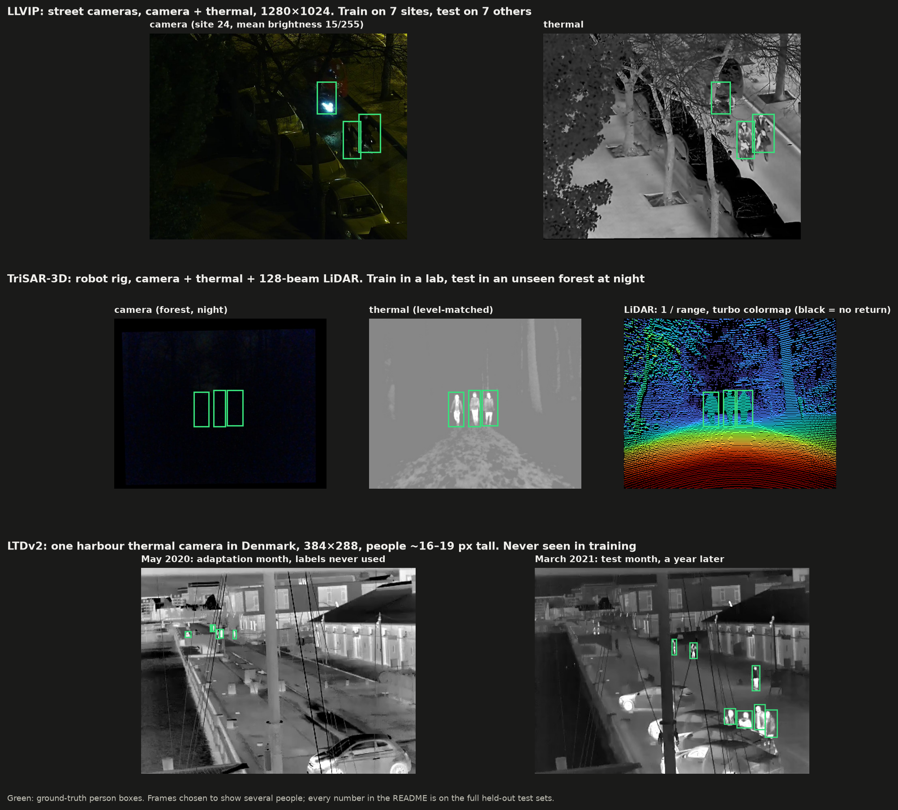
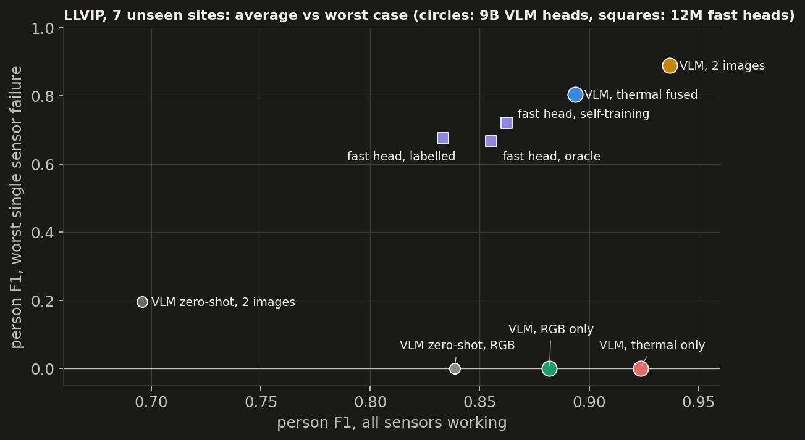
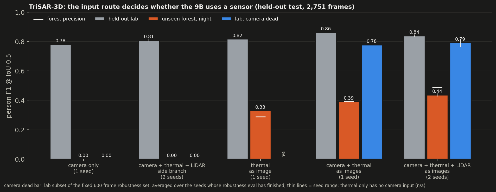

# Night Watch: camera + thermal + LiDAR person detection after dark

**Goal.** Security robots and cameras have to find people at night, when the visible camera is close to useless.
Thermal and LiDAR still work there. Night Watch is a small, end-to-end version of the stack that needs:
- a large **vision-language model (VLM) as a slow, accurate head** that reads every sensor and writes an incident report
- a **12M-parameter detector as the fast head** that runs on the robot (0.7 ms on TensorRT), taught by the VLM
- **evaluation only on sites the models never saw**, with fail-closed regression gates

Three questions drive every experiment:

| | question | short answer |
|---|---|---|
| **Q1 Fusion** | How should a 9B VLM receive thermal and LiDAR so that it actually *uses* them? | Feed each sensor as its own image. A custom fusion branch lost on every site, and on TriSAR the VLM ignored it. |
| **Q2 Distillation** | Can the VLM teach a small edge detector? | On familiar data, not better than self-training (F1 0.85 vs 0.86). On a truly new site, yes: F1 0.13 → 0.46 with no human labels. |
| **Q3 New sites** | Does it hold up where it was never trained? | Partly. Unseen forest at night: 0.00 → 0.44 F1 once thermal enters as an image. Unseen harbour: 75 % of the gap to human labels closed. |


*Unseen forest at night (TriSAR-3D test). The camera is almost black; thermal and LiDAR still show the people.*

---

## Contents
1. [Datasets](#1-datasets)
2. [System](#2-system)
3. [How results are measured](#3-how-results-are-measured)
4. [Q1 Fusion: how should the VLM see thermal and LiDAR?](#4-q1-fusion-how-should-the-vlm-see-thermal-and-lidar)
5. [Q2 Distillation: can the VLM teach the edge detector?](#5-q2-distillation-can-the-vlm-teach-the-edge-detector)
6. [Q3 A genuinely new site: the LTDv2 harbour](#6-q3-a-genuinely-new-site-the-ltdv2-harbour)
7. [What did not work](#7-what-did-not-work)
8. [Repository and how to run](#8-repository-and-how-to-run)

---

## 1. Datasets

Three public datasets, each split so that the test data comes from **a place (or time) never used for training or tuning**.

| | **LLVIP** | **TriSAR-3D** | **LTDv2** |
|---|---|---|---|
| Sensors | camera + thermal | camera + thermal + 128-beam LiDAR | thermal only |
| Scene | street surveillance cameras, night | robot sensor rig: indoor lab, outdoor forest | one fixed harbour camera, Denmark |
| Resolution | 1280×1024 | 640×512 (all sensors rendered into the thermal camera) | 384×288; people ~16–19 px tall |
| Labels | person boxes | 3D person boxes, posture, range | person boxes |
| Split (ours) | **by scene**: train sites 01–07, validation site 25, test sites 19–24 and 26 | **by sequence**: train in the lab; test = whole night forest + 2 held-out lab sequences | **by time**: adapt on May 2020, test on March–April 2021 |
| Size used | 3,438 labelled + 8,164 unlabelled (sites 08–18) + 3,463 test | 9,832 frames; test 2,751 (forest 2,119, lab 632) | 2,000 unlabelled adaptation frames; test 15,925 frames in 142 clips |
| Used for | Q1, Q2 | Q1, Q3 | Q2, Q3 |



Why these splits:
- LLVIP's official split mixes sites, and TriSAR's is frame-level within sequences. Both leak near-duplicate frames
  into the test set, so I re-split by site and sequence.
- In LLVIP sites 08–18, I hide the labels and treat them as "field data" that the VLM labels for the small detector.

## 2. System


| | slow head | fast head |
|---|---|---|
| Model | Qwen3.5-9B + LoRA (r = 32) | CenterNet, ResNet18-FPN, 12M parameters |
| Input | every sensor as its own image (final design) | early-fused sensor channels |
| Output | JSON report per person: box, posture, distance in metres | person boxes |
| Runs | on escalation (server / big GPU) | every frame, on the robot: 0.7 ms TensorRT, no NMS |
| Trained on | human labels from the training sites only | human labels + the VLM's labels on unlabelled data |

Two fusion designs were compared for the slow head:
1. **Side branch:** a DINOv3 encoder per extra sensor, added onto the VLM's visual tokens through zero-initialised
   projections (ControlNet-style). Same token count as camera alone; at step 0 it is exactly the pretrained VLM.
2. **Sensors as images:** thermal (level-matched per frame) and LiDAR (1/range through a turbo colormap) enter the
   VLM's own image encoder as extra images. More tokens, no new modules.

## 3. How results are measured

- **Held-out sites only.** No test site, sequence or month was used for training, thresholds or model choice.
- **Confidence intervals by site or clip, not by frame.** I resample whole sites (LLVIP), sequences (TriSAR) or
  clips (LTDv2), because frames from one place are not independent.
- **Seeds.** Three seeds wherever results vary by seed; single-seed rows are labelled.
- **Same frames.** Every compared row is scored on identical frames.
- **Fail-closed regression gates** (`nightwatch/eval/gate.py`). A new model ships only if it is no worse on any
  slice: per site, darkest 25 %, crowded, camera dead, thermal dead.
- **Pre-registration.** The follow-up experiments had their success criteria and primary contrast written down
  before training. Anything decided after seeing results is labelled post hoc.
- **Independent reviews.** An AI reviewer audited progress every 45 minutes; every finding was fixed, deferred or
  rejected with a reason.

Metric: person F1 at IoU 0.5 unless stated.

## 4. Q1 Fusion: how should the VLM see thermal and LiDAR?

### LLVIP: camera + thermal, 1,500 test frames from 7 unseen sites

| Qwen3.5-9B | F1 | 95 % site CI | camera dead | thermal dead |
|---|---|---|---|---|
| zero-shot, camera | 0.839 | 0.80–0.88 | 0.00 | n/a |
| zero-shot, camera + thermal as two images | 0.696 | 0.64–0.78 | 0.20 | 0.83 |
| fine-tuned, camera only | 0.882 | 0.83–0.92 | 0.00 | n/a |
| fine-tuned, thermal only | 0.923 | 0.89–0.95 | n/a | 0.00 |
| fine-tuned, **side-branch fusion** | 0.894 | 0.87–0.93 | 0.80 | 0.88 |
| fine-tuned, **two images**, same token budget as the side branch | 0.928 | 0.90–0.94 | 0.91 | 0.88 |
| fine-tuned, **two images** | **0.937** | **0.92–0.95** | **0.93** | **0.89** |

- **Fine-tuning works.** Camera-only fine-tuning beats zero-shot by +0.043 [+0.005, +0.072].
- **The simplest fusion wins.** My side branch loses to two images by 0.043 [0.013, 0.071], on all 7 sites. At an
  equal token budget it still loses by 0.035 [0.006, 0.063] on 7/7 sites, and the regression gate blocked it.
- Zero-shot, two images was the *worst* input (it counts people twice). That result motivated the side branch, and
  it does not survive fine-tuning.



### TriSAR-3D: camera + thermal + LiDAR, lab-trained, tested on an unseen forest at night

| Qwen3.5-9B | seeds | all frames | unseen forest | held-out lab | lab, camera dead | precision |
|---|---|---|---|---|---|---|
| zero-shot, camera (600-frame subset) | 1 | 0.07 | 0.00 | 0.26 | – | 0.10 |
| fine-tuned, camera only | 1 | 0.25 | 0.00 | 0.78 | 0.00 | 0.78 |
| fine-tuned, side-branch fusion of thermal + LiDAR | 2 | 0.26 | 0.00 | 0.81 | 0.00 | 0.82 |
| fine-tuned, thermal as an image | 1 | 0.41 | 0.33 | 0.82 | n/a | 0.37 |
| fine-tuned, camera + thermal as images | 1 | 0.48 | 0.39 | **0.86** | 0.78 | 0.48 |
| **fine-tuned, camera + thermal + LiDAR as images** | 2 | **0.52** (0.51–0.53) | **0.44** (0.43–0.44) | 0.84 | **0.79** (0.77–0.82) | 0.57 |

- **The input route decides whether the VLM uses a sensor.** As a side branch, thermal and LiDAR were ignored:
  switching them off changed lab F1 by < 0.03, and with the camera dead the model output one memorised box.
  As images, the same thermal data lets the VLM see in the black forest for the first time.
- **Pre-registered criteria for the three-image model:**

  | criterion | bar | result |
  |---|---|---|
  | A1: works with the camera dead | lab F1 ≥ 0.50 | **pass** (0.82 / 0.77) |
  | A2: each extra sensor matters | thermal off and LiDAR off each cost ≥ 0.03 | **fail**: thermal matters (forest 0.43 → 0.15 without it); LiDAR does not (≤ 0.01) |
  | A3: few false alarms | precision ≥ 0.70 | **fail** (0.60 / 0.54) |

- On the full report (box + posture + distance all correct) the two-image model is best: 0.316 vs 0.28–0.29 for three
  images, whose distance error is larger.



## 5. Q2 Distillation: can the VLM teach the edge detector?

LLVIP: the 12M head learns from the 7 labelled sites, plus labels on the 11 unlabelled sites from either itself
(self-training) or the 9B.

Full 3,463-frame test set (7 unseen sites), mean (range) over 3 seeds:

| 12M fast head, labels on the 11 unlabelled sites | F1 | AP50 |
|---|---|---|
| none (7 labelled sites only) | 0.821 (0.805–0.833) | 0.872 |
| none, trained as many steps (compute-matched) | 0.844 (0.827–0.861) | – |
| **its own labels (self-training)** | **0.859** (0.855–0.862) | 0.893 |
| the 9B's labels | 0.832 (0.827–0.836) | 0.907 |
| the 9B's labels, kept where the small head agrees | 0.853 (0.830–0.868) | **0.915** |
| human labels on all 18 sites (upper bound, 1 seed) | 0.855 | 0.912 |

- **On familiar ground the teacher adds nothing on F1.** The best 9B student matches self-training (seed 2: +0.005
  [−0.008, +0.019]) and is less stable across seeds. Plain 9B labels are below self-training on all 3 seeds. What
  the 9B transfers is ranking quality: AP50 at the human-label level.
- **Self-training is more than extra steps:** +0.015 over the compute-matched control.
- **Escalation:** sending the 20 % least certain frames to the 9B recovers 61 % of the fast → slow gap on LLVIP
  (random: 28 %). On TriSAR, where the 9B is blind at night without thermal, the same rule loses to random.

## 6. Q3 A genuinely new site: the LTDv2 harbour

The LLVIP thermal fast head (F1 0.860 at home) is dropped onto a harbour camera in another country. It adapts on one
unlabelled month and is tested a year later. Every arm gets the same 3,000 fine-tuning steps from the same start
model; thresholds come from LLVIP validation only. 3 seeds per arm.

| labels for the adaptation month | F1, mean (range) | AP50 | F1 back home (LLVIP) |
|---|---|---|---|
| none (zero-shot) | 0.132 | 0.072 | 0.860 |
| none, same extra steps on LLVIP | 0.135 (0.130–0.138) | 0.067 | 0.864 |
| the fast head's own labels (self-training) | 0.140 (0.129–0.145) | 0.085 | 0.863 |
| 9B boxes kept where the fast head agrees | 0.234 (0.228–0.246) | 0.219 | 0.862 |
| **the thermal 9B's labels** | **0.460** (0.446–0.469) | **0.373** | 0.866 |
| human labels (upper bound) | 0.570 (0.565–0.574) | 0.520 | 0.859 |

Paired bootstrap over 142 test clips, per seed:
- **Pre-registered primary** (9B + agreement vs self-training): +0.098, +0.101, +0.083. The 95 % CI excludes 0 on every seed.
- Pre-registered secondary (self-training vs extra steps): ≤ +0.008, about nothing.
- 9B labels vs self-training: +0.30 to +0.34 (post hoc: not the pre-registered arm).

**Result:** with no human label at the new site, the 9B's labels close **75 %** of the gap between zero-shot and human
labels, and no arm gets worse at home. At the harbour the small head finds 5 % of people, so its own labels are
nearly empty. **The teacher matters when the student is out of its depth.** That is the opposite of LLVIP.

## 7. What did not work

- **My side-branch fusion** lost to plain multi-image input on LLVIP, and was ignored on TriSAR.
- **Camera dropout taught hallucination.** A fused VLM trained with 20 % camera dropout reported 3,373 people in the
  forest, nearly all wrong. Without dropout it reported none. Keeping labels on blacked-out frames teaches "black
  camera ⇒ people".
- **LiDAR is still unused** by the VLM, even as an image (criterion A2 failed on 2 seeds).
- **Precision on TriSAR** (0.54–0.60) is below the 0.70 bar.
- **Distillation on LLVIP** gave no F1 gain over self-training.
- **Uncertainty-based escalation on TriSAR** lost to random escalation.
- **Misaligned thermal is worse than no thermal** (LLVIP 0.53 vs 0.88): a sync fault is more dangerous than a dead camera.

## 8. Repository and how to run

```
nightwatch/
  data/     dataset loaders, splits, task formats (llvip.py, trisar.py, ltd.py)
  slow/     VLM fine-tuning and inference (train.py, infer.py, data_trisar.py, model.py)
  fast/     12M detector, pseudo-labelling, LTDv2 adaptation and bootstrap
  eval/     metrics, site bootstrap, regression gates, routers
  report/   every figure and table in this README
scripts/    pod entry point (pod.sh) and resumable run scripts
docs/       RESULTS.md (all tables), media
```

```bash
bash scripts/setup.sh        # dependencies, LLVIP, Qwen3.5-9B, DINOv3 weights, index
bash scripts/run_all.sh      # LLVIP stage, resumable; logs/, runs/, report/
bash scripts/run_trisar.sh   # TriSAR stage
MODE=tri SEED=0 bash scripts/run_tri.sh   # sensors-as-images slow head
bash scripts/run_ltd_adapt.sh             # LTDv2 adaptation arms
```

Further reading:
- [docs/RESULTS.md](docs/RESULTS.md): every table, including fast-head routing and per-run ablations
- [docs/BLOG_DRAFT.md](docs/BLOG_DRAFT.md): the project as a story
