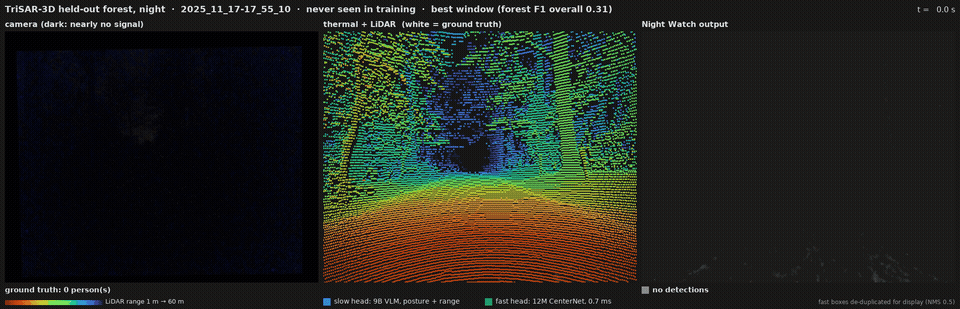
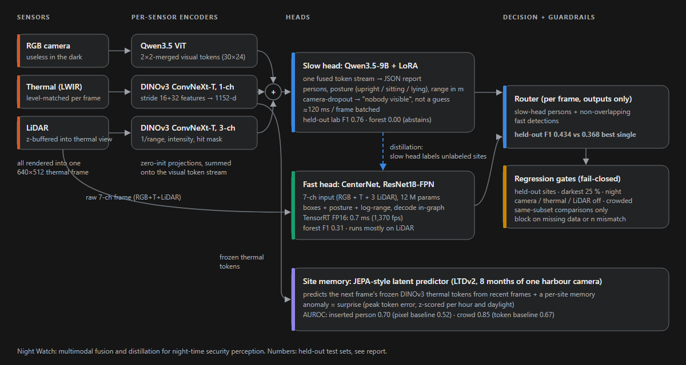
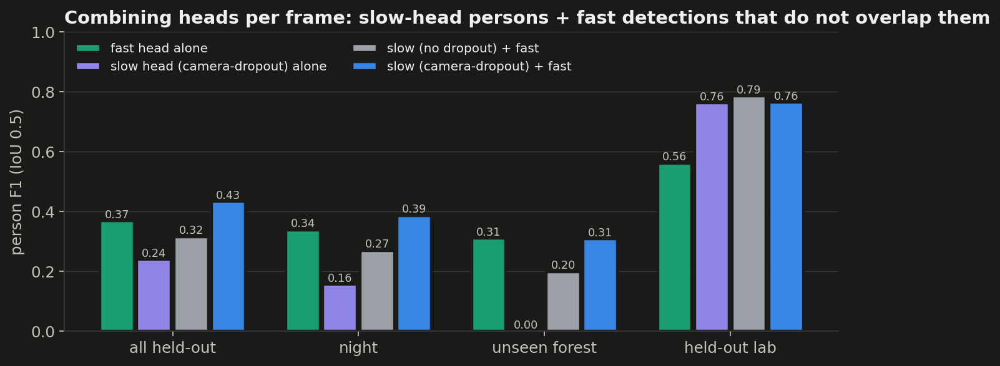
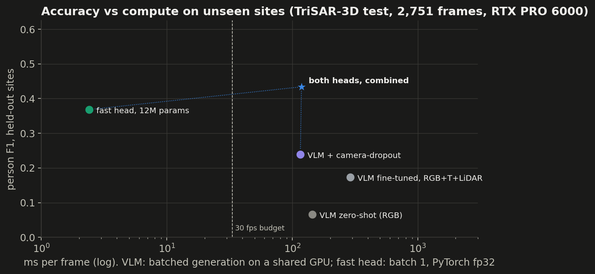

# Night Watch: camera + thermal + LiDAR perception for security robots after dark

Two heads read one fused sensor frame. A **9B vision-language model** (Qwen3.5-9B + LoRA) writes an incident
report with posture and metric range. A **12M-parameter detector** runs in 0.7 ms on TensorRT. Every number below comes
from **sites neither model saw in training**, including a forest at night where the camera is black.



*Unseen forest, night (TriSAR-3D test). Left: the camera is almost black. Middle: thermal plus LiDAR coloured by range, with
ground truth in white. Right: the VLM says "nobody visible" and the LiDAR-driven fast head finds both people with
posture and range. This window was chosen as the forest's best; the forest's overall F1 is 0.31.*



## Results at a glance (TriSAR-3D held-out test, 2,751 frames, person F1 @ IoU 0.5)

| system | all | night | unseen forest | held-out lab |
|---|---|---|---|---|
| VLM zero-shot, RGB (600-frame subset) | 0.07 | – | – | – |
| VLM fine-tuned, RGB + thermal + LiDAR | 0.17 | 0.11 | 0.00 | **0.79** |
| … + camera-dropout 0.5 | 0.24 | 0.16 | 0.00 | 0.76 |
| fast head, 12M (mean of 3 seeds, range) | 0.36 (0.30–0.40) | 0.33 (0.27–0.38) | **0.30 (0.24–0.36)** | 0.56 (0.55–0.57) |
| combined: VLM (camera-dropout) + non-overlapping fast detections (3 seeds) | 0.42 (0.35–0.46) | 0.37 (0.31–0.42) | 0.30 (0.24–0.35) | 0.76 |
| fast head + per-frame thermal normalisation (3 seeds) | 0.42 (0.37–0.45) | 0.39 (0.35–0.43) | **0.37 (0.31–0.42)** | 0.56 (0.56–0.57) |
| **combined: VLM (camera-dropout) + normalised fast head** (3 seeds) | **0.47 (0.44–0.51)** | **0.43 (0.39–0.47)** | 0.37 (0.31–0.42) | 0.76 |

What the runs show:

1. **Combining the heads wins, but only with a VLM that abstains.** The combined output gains +0.066, +0.065 and +0.054
   F1 over the fast head alone, one gain per fast-head seed. The absolute level varies a lot by seed (fast head 0.30–0.40,
   and validation F1 does not predict which seed generalises), but the gain does not. The same combination with the VLM trained without camera-dropout
   *loses* to the fast head (0.32 vs 0.37), because that VLM invents people in the dark.
2. **Camera-dropout turned hallucination into abstention.** On 2,119 forest frames the earlier VLM reported 3,373 people,
   nearly all wrong. The camera-dropout VLM answers "nobody" on 2,099 of them. Precision went 0.20 → 0.75.
3. **On TriSAR, the VLM's evidence still comes through the camera.** With the camera off, the camera-dropout VLM emits
   the same memorised box on all 600 test frames, and thermal level-matching does not change its forest F1 (0.00). The
   fusion design itself can carry localisation: on LLVIP, the same side-branch fusion keeps **F1 0.80 with the camera
   off**. The TriSAR failure is specific to that setup (one epoch on 6k frames, a harder report task, and a large thermal
   domain gap), not a limit of the architecture.
4. **The fast head runs on LiDAR, until thermal is normalised.** Across 3 seeds, LiDAR off drops the plain fast head
   from 0.30–0.40 to 0.19–0.24, and thermal off does not hurt it, because raw thermal shifts between sites. A per-frame
   thermal level match applied in training *and* inference makes thermal usable:
   - With LiDAR off, every normalised seed (0.26–0.31) beats every plain seed.
   - Mean forest F1 rises 0.30 → 0.37, though the seed ranges still overlap.
   - Lab and validation scores do not move. Only the unseen site shows the difference.
   - The trick was prompted by the forest failure, so it counts as a development result.
5. **Escalating the VLM only on uncertain frames did not beat random escalation.** Fast-head doubt sits in the forest,
   where the VLM abstains. This is logged as a negative result.




## LLVIP: fusion and distillation (RGB + thermal street cameras, 1,500 frames from 7 unseen sites)

95 % intervals come from resampling whole sites, not frames. Every row is scored on the same frames; "darkest 25 %" is the 375 frames with the lowest camera brightness.

| model | F1 | 95 % site CI | camera off | darkest 25 % |
|---|---|---|---|---|
| Qwen3.5-9B zero-shot, RGB | 0.839 | 0.80–0.88 | 0.00 | 0.832 |
| zero-shot, thermal as a 2nd image | 0.696 | 0.64–0.78 | 0.20 | – |
| **9B fine-tuned, thermal fused onto its tokens** | **0.894** | 0.87–0.93 | **0.80** | **0.902** |
| 12M fast head, 7 labelled sites (3 seeds) | 0.82 (0.80–0.83) | | | 0.77 (0.75–0.79) |
| 12M fast head, self-training on the 11 unlabeled sites (control) | 0.862* | | | |
| 12M student of the 9B, consensus-filtered labels on 11 unlabeled sites (1 seed) | 0.866 | 0.83–0.89 | | 0.852 |
| 12M fast head, human labels on all 18 sites (oracle) | 0.857 | 0.83–0.88 | | 0.839 |

- Fusion lifts the 9B model on all 7 sites (+0.055 over zero-shot, CI +0.035 to +0.076). It still finds people with the
  camera black (0.80). Thermal as a plain second image *hurts* on all 7 sites.
- **Distillation from the 9B did not beat self-training on F1.** Pseudo-labelling the 11 unlabeled sites closes the gap
  to the human-label oracle, but the 12M head's own labels do it equally well (0.862 vs 0.862 for the consensus-filtered
  9B labels, Δ 0.000 [−0.014, +0.017]). The pre-registered self-training control caught this. The teacher's labels do
  transfer ranking quality: AP50 0.912 vs 0.893 for self-training and 0.877 labelled-only. Its labels on the unlabeled
  sites (F1 0.82 vs withheld GT, with hallucinated lamps and foliage at two bright sites) are no better than the small
  head's own confident labels on easy LLVIP pedestrians.
- **Fusion is spatial, and misalignment is dangerous.** With thermal taken from a different frame, the 9B drops to 0.53
  (0.88 with thermal simply off). A sync or calibration fault is worse than a dead thermal camera.

\* full 3,463-frame test set; the other rows use the 1,500-frame subset.
- Escalation works when the slow head is competent everywhere. Sending the 20 % most uncertain frames to the 9B
  recovers 61 % of the fast→slow gap (random: 28 %). On TriSAR, where the 9B is blind at night, the same rule loses to
  random. Routing must know which head to trust for the scene.

Site memory: a JEPA-style latent predictor on LTDv2 (one harbour camera over 8 months) detects inserted persons at AUROC
0.70 (pixel baseline 0.52) and crowds at 0.85 (token baseline 0.67).

Engineering notes:
- Every comparison is same-subset, and regression gates fail closed.
- Four leak and overwrite bugs were caught before they reached results; see `docs/LAB_NOTES.md` §2.
- Independent reviews (Fable, Astra) and their triage are in `docs/reviews/`.

---

## Design (stage 1, LLVIP)

A small-scale, end-to-end version of a multi-sensor perception stack for security robots:

1. **Native sensor encoders**: the VLM's own ViT for the visible camera, plus a DINOv3 ConvNeXt with a
   1-channel stem for raw thermal.
2. **Fusion**: thermal features land exactly on the VLM's 2×2-merged visual token grid (stride 32 ↔ 32 px
   tokens), and are added onto the RGB tokens (and onto DeepStack levels where the VLM has them) through
   zero-initialised output projections (ControlNet-style; a zero *gate* was tested and starves the
   projection of gradient, so the model never used thermal). The result is one spatially aligned token stream with the same token budget as RGB alone, and
   at step 0 the model is exactly the pretrained VLM.
3. **Slow head**: Qwen3.5-9B (natively multimodal, Feb 2026; any Qwen3.5/3.6 or Qwen3-VL works via `NW_MODEL`), LoRA-tuned to reason over the fused stream (grounding, counting, zone
   checks). It is trained on 7 labeled sites only.
4. **Fast head**: a 12M-parameter CenterNet on early-fused RGB+T, distilled from the slow head's labels on
   11 unlabeled sites. It has no NMS, exports to ONNX/TensorRT, and sees every frame. Only ambiguous
   frames escalate to the slow head.
5. **Evaluation**: every test number comes from **held-out sites** (LLVIP test scenes share no location
   with training). The slices are darkest-25%, crowded, per-site, far/mid/near persons, *visible camera
   dead* and *thermal dead*. A regression gate blocks any candidate that is worse on any slice.

## Data: LLVIP, split by scene

| split | scenes | frames | used for |
|---|---|---|---|
| labeled | 01–07 | 3,438 | slow-head SFT (the only human labels the slow head sees) |
| val | 25 | 423 | checkpoint + threshold selection |
| unlabeled | 08–18 | 8,164 | "field data": the slow head labels it, the fast head learns from that |
| test | 19–24, 26 | 3,463 | held-out sites, reporting only |

## Experiments

| id | what | question |
|---|---|---|
| `zs_rgb`, `zs_dual` | zero-shot Qwen3.5-9B | how far does the open model get with no training? |
| `sft_rgb` | LoRA, visible only | how much does fine-tuning alone buy? |
| `sft_dual` | LoRA, thermal as a 2nd image | strong simple baseline (2× tokens) |
| `sft_fusion` | **ours**: native thermal encoder + gated token fusion | same tokens as RGB alone. Better? More robust? |
| `fast_gt_labeled` | fast head on the 7 labeled sites | what the labels alone buy |
| `fast_distill` | fast head on labeled + slow-head pseudo-labels | does the slow head's knowledge transfer? |
| `fast_oracle` | fast head on all GT | upper bound |
| `fast_oracle_rgb/_t` | single-sensor ablations | what each sensor contributes |

## Stage 2 — TriSAR-3D: RGB + thermal + LiDAR (CC-BY-4.0, TU Darmstadt, Oct 2026)

19.7k synchronised frames from a 128-beam Ouster LiDAR, an RGB camera and a FLIR thermal camera, with 52k 3D person
boxes and posture tags (standing, walking, sitting, lying). Everything is rendered into one reference frame, the
undistorted thermal camera:

- RGB is warped in with the infinite-depth homography. The cameras are about 10 cm apart, so residual parallax is a few
  pixels, well under one visual token.
- LiDAR is z-buffer projected into inverse-range, intensity and hit maps.
- 3D boxes are projected to tight 2D boxes and keep their posture and metric range.

LiDAR therefore enters the slow head exactly like thermal: its own DINOv3 encoder, added onto the same visual token grid
through a zero-initialised projection.

**Split (ours, by sequence):** test is the whole forest (an unseen site at night) plus two held-out lab sequences with
lying persons. The official split is frame-level within sequences, which leaks near-duplicate frames.

**Task:** an incident report per person, `{"bbox_2d", "pose": upright|sitting|lying, "distance_m"}`, plus "is anyone
lying down?" and "how far is the nearest person?". Every answer is checked against the 3D labels.

| id | sensors | question |
|---|---|---|
| `t_zs_rgb` | RGB, zero-shot | what does the stock VLM get? |
| `t_sft_rgb` → `t_sft_fusion` → `t_sft_fusion_l` | RGB → +thermal → +LiDAR | what does each sensor add? |
| `tf_rgb`, `tf_rgbt`, `tf_tl`, `tf_rgbtl` | fast head, same ladder | does the fast head need the camera at all? |

Run it with `bash scripts/run_trisar.sh`.

## Run

```bash
bash scripts/setup.sh        # deps, LLVIP (4 GB), Qwen3.5-9B, DINOv3 weights, index
bash scripts/run_all.sh      # everything, resumable; logs in logs/, results in runs/, report in report/
```

Multi-GPU slow head: `torchrun --nproc_per_node 8 -m nightwatch.slow.train --mode fusion ...`.
