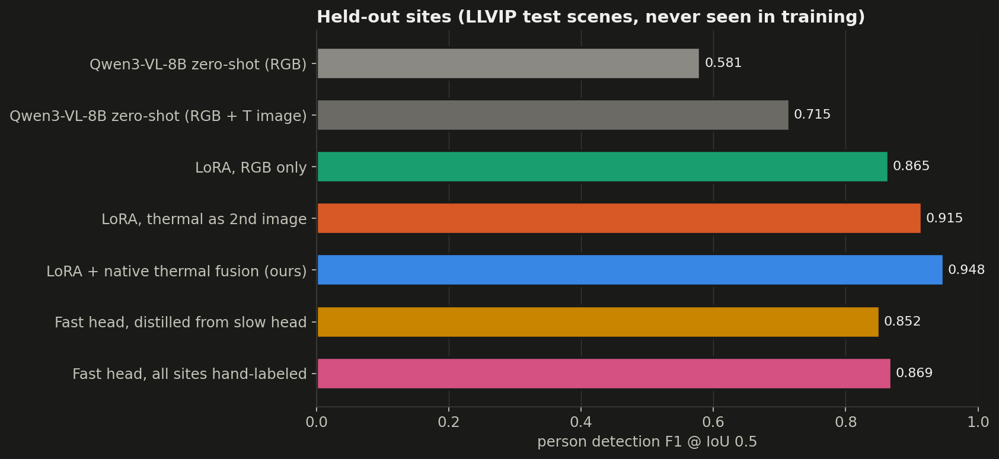
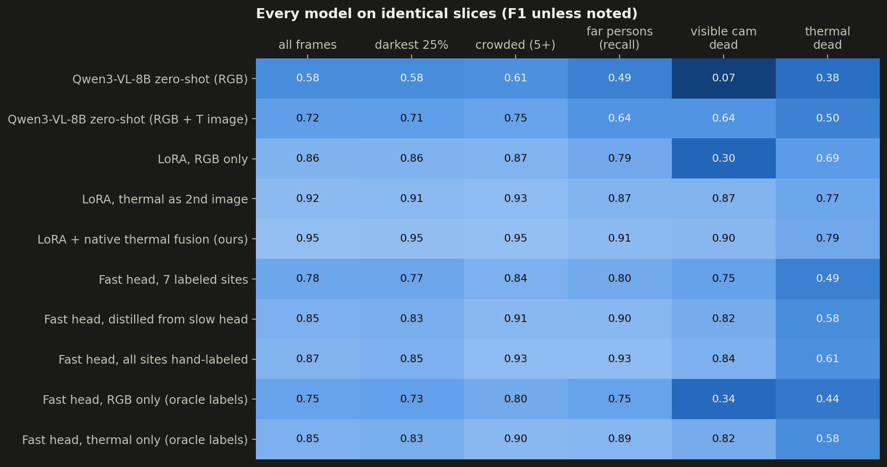
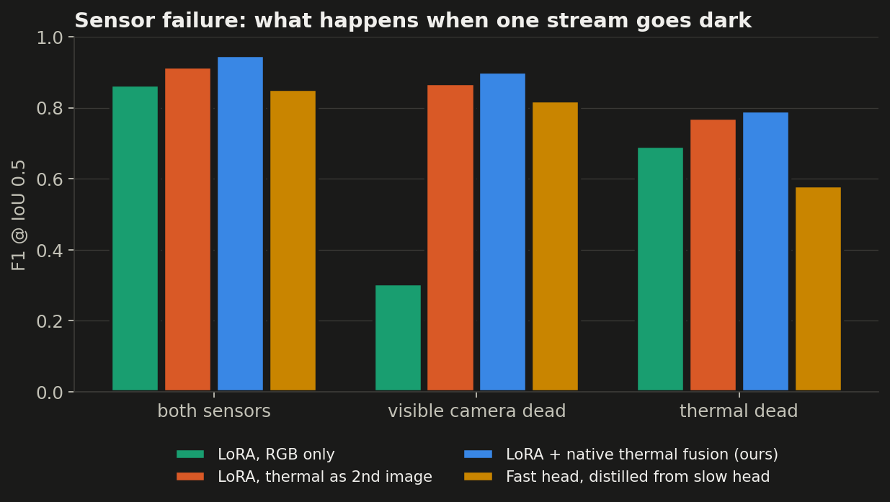
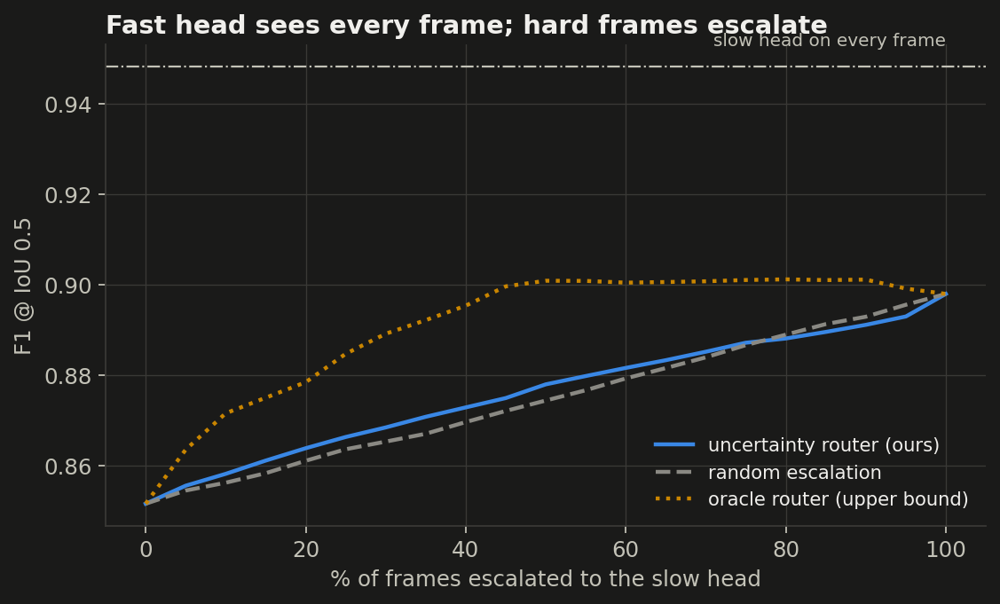
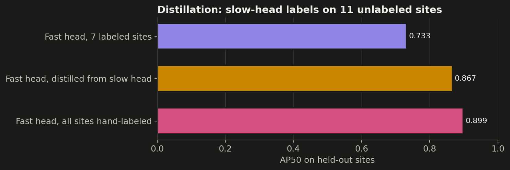
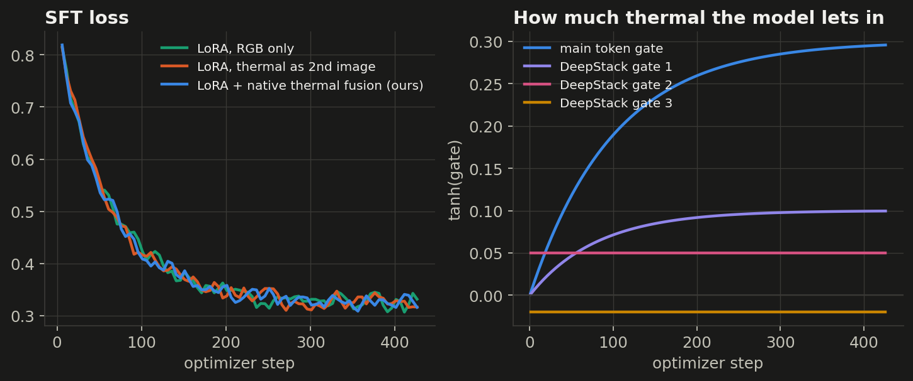
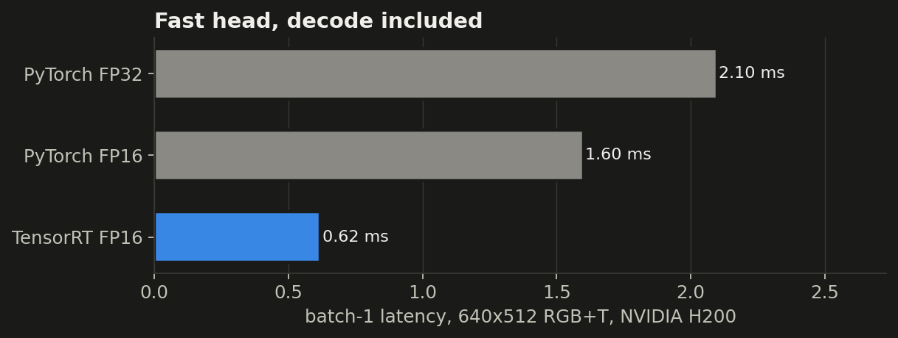
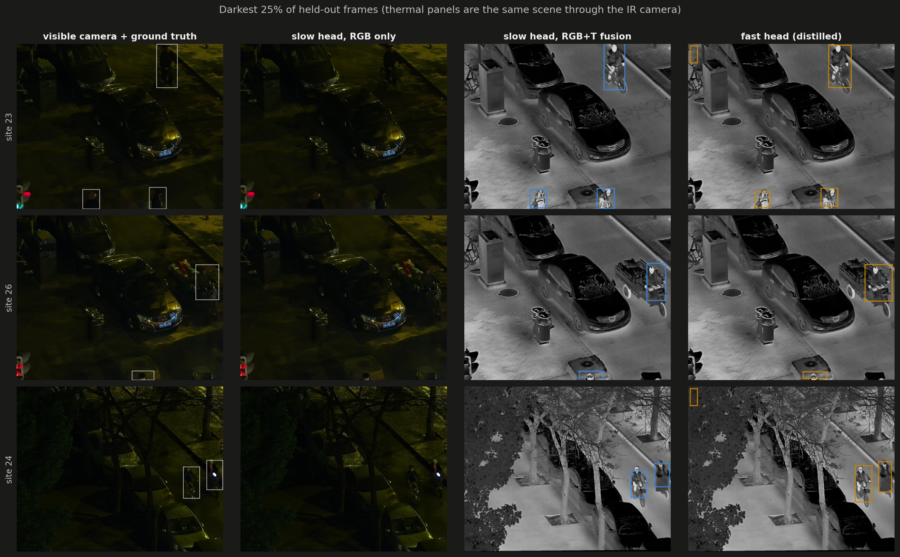

# Night Watch: results

| model | F1 all | F1 darkest 25% | F1 camera dead | F1 thermal dead | count exact | img/s |
|---|---|---|---|---|---|---|
| Qwen3-VL-8B zero-shot (RGB) | 0.581 | 0.578 | 0.068 | 0.376 | 0.358 | 6 |
| Qwen3-VL-8B zero-shot (RGB + T image) | 0.715 | 0.712 | 0.638 | 0.502 | 0.413 | 6 |
| LoRA, RGB only | 0.865 | 0.862 | 0.305 | 0.693 | 0.582 | 6 |
| LoRA, thermal as 2nd image | 0.915 | 0.908 | 0.867 | 0.771 | 0.694 | 6 |
| LoRA + native thermal fusion (ours) | 0.948 | 0.945 | 0.900 | 0.790 | 0.789 | 6 |
| Fast head, 7 labeled sites | 0.780 | 0.766 | 0.745 | 0.492 | 0.442 | 1612 |
| Fast head, distilled from slow head | 0.852 | 0.832 | 0.819 | 0.580 | 0.515 | 1612 |
| Fast head, all sites hand-labeled | 0.869 | 0.848 | 0.844 | 0.608 | 0.541 | 1612 |
| Fast head, RGB only (oracle labels) | 0.747 | 0.728 | 0.338 | 0.435 | 0.427 | 1612 |
| Fast head, thermal only (oracle labels) | 0.849 | 0.830 | 0.817 | 0.581 | 0.525 | 1612 |

Regression gate (fusion vs dual-image baseline): **SHIP**